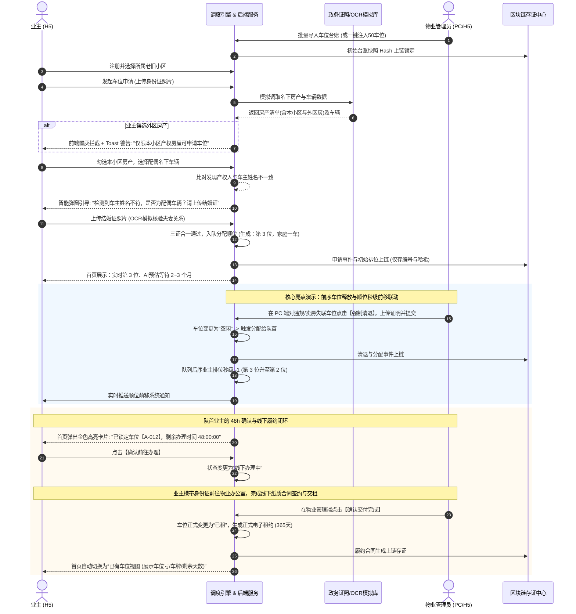
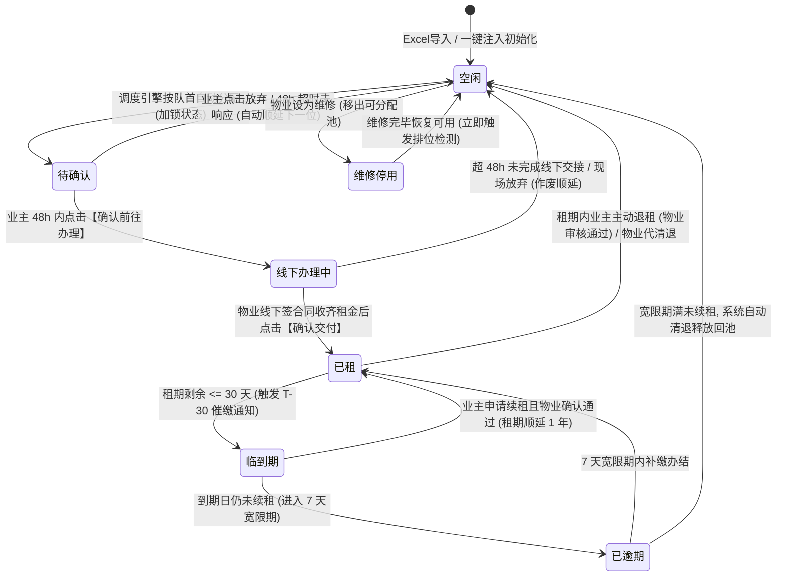
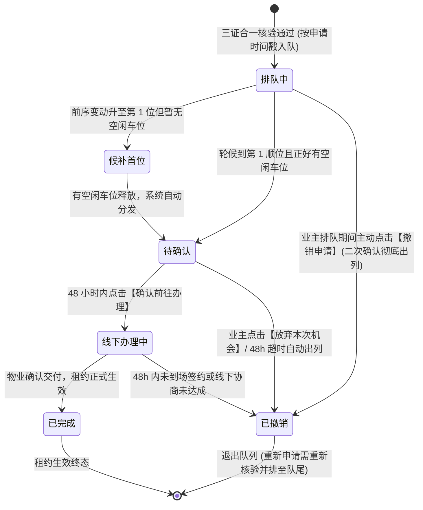

# 老旧小区停车位管理系统 产品需求规格说明书 (PRD)

| 文档名称 | 老旧小区停车管理系统产品需求规格说明书 (PRD) |
| :--- | :--- |
| **文档版本** | **V3.0 (三轮深度Review与张总评审终极交付版)** |
| **编制日期** | 2026-09-07 |
| **项目里程碑** | **周二 (明天) 下班前交付前后端全栈可交互 Demo；周三下午向张总汇报评审** |
| **系统架构** | **Vue 3 + Vite + Tailwind CSS + Python (FastAPI) + SQLite 本地数据库** |
| **核心业务闭环** | **三证合一准入(隐私合规) -> FIFO公平排位 -> 线下履约闭环 -> 48h倒计时清退 -> 虚拟区块链存证** |

---

## 目录
1. [项目背景、核心痛点与系统建设原则](#1-项目背景核心痛点与系统建设原则)
2. [三轮深度Review优化对标清单 (Word vs PRD)](#2-三轮深度review优化对标清单-word-vs-prd)
3. [系统总体架构与全角色权限体系](#3-系统总体架构与全角色权限体系)
4. [核心业务端到端全景时序泳道图](#4-核心业务端到端全景时序泳道图)
5. [两套核心状态机全流转设计 (含原子调度引擎)](#5-两套核心状态机全流转设计-含原子调度引擎)
6. [业主端 (移动H5) 详细功能规格](#6-业主端-移动h5-详细功能规格)
7. [物业管理端 (H5 + PC自适应) 详细功能规格](#7-物业管理端-h5--pc自适应-详细功能规格)
8. [关键算法规则、数据安全脱敏与隐私合规规范](#8-关键算法规则数据安全脱敏与隐私合规规范)
9. [虚拟区块链存证中心技术实现规范](#9-虚拟区块链存证中心技术实现规范)
10. [数据库实体设计 (ER) 与 API 接口规范](#10-数据库实体设计-er-与-api-接口规范)
11. [周三向张总汇报：经典四幕演示剧本与预置账号矩阵](#11-周三向张总汇报经典四幕演示剧本与预置账号矩阵)
12. [明天(周二)下班交付落地实施排期与自测标准](#12-明天周二下班交付落地实施排期与自测标准)

---

## 1. 项目背景、核心痛点与系统建设原则

### 1.1 核心业务痛点
1. **车位供需极度失衡**：老旧小区（公房）建设年代早、停车位先天规划严重不足（如仅 50 个车位，业主车辆达数百辆）。
2. **分配规则不透明**：传统手工账或人情分配导致“先到先得、私下转租倒卖、插队争议”不断，是邻里与物业矛盾的高发诱因。
3. **资质准入审核难**：外来车辆借壳停放、二手房交易后老车位未主动退出、产权人与车辆登记人不一致（如夫妻共有）缺乏标准化核验依据。
4. **缺乏权威公信力**：传统台账易涂改，排位变动无据可查，物业自证清白困难。

### 1.2 建设目标与四大铁律原则
- **公平性 (Fairness)**：车位分配完全由系统调度引擎依据时间戳严格执行 FIFO（先进先出）。**物业后台坚决不开放任何“手动指定/插队分配”按钮**，从技术底层杜绝权力寻租。
- **阳光透明 (Transparency)**：顺位全队列实行统一脱敏公示，全小区业主可相互监督；个人顺位历史变动（前移原因、时间戳）全流程可见。
- **免材料严审 (Compliance)**：对接政务电子证照，实人核验通过后直接调取房产证与行驶证数据，免去纸质复印件；对“夫妻车”提供智能识别与结婚证补充核验通道。**严格落实隐私最小化：系统仅保存证照编号与核验结果，绝不持久化存储证照原件扫描件**。
- **全流程存证 (Traceability)**：全流程关键行为记录 SHA-256 交易哈希、虚拟区块高度与防伪凭据，形成不可篡改的审计日志链条。
- **线上线下严谨解耦 (O2O Boundary)**：线上负责“资格审核、排位流转、催缴倒计时与存证记账”；线下负责“纸质合同签约、押金租金收缴与车位钥匙/蓝牙卡交接”。

---

## 2. 三轮深度Review优化对标清单 (Word vs PRD)

经过对照原始 Word 规格书与用户口述业务细节的三轮全面 Review，本次版本针对性完成了以下优化升级：

```
┌─────────────────────────────────────────────────────────────────────────────┐
│                       三轮深度 Review 优化全景图                             │
├─────────────────────────────────────────────────────────────────────────────┤
│ 【第一轮：业务功能与边界完整性】                                            │
│  ✔ 补充政务隐私合规条款：明确仅存证照编号与Hash，不保存证照原件图片         │
│  ✔ 补充家庭成员绑定体系：主申请人与家庭成员副账号权限（仅主账号可发起申请）│
│  ✔ 健全通知时效与多级催缴机制：完善 T-30/T-7/T-1 到期梯度与宽限期通知     │
│  ✔ 增加自检巡检机制：台账数据与队列一致性巡检规则                          │
├─────────────────────────────────────────────────────────────────────────────┤
│ 【第二轮：系统交互流程与逻辑严密性】                                        │
│  ✔ 细化“候补第1位”状态感知：当业主升至第1位但暂无空位时的专属状态呈现      │
│  ✔ 增加“线下办理超时”约束：业主点击确认后限定48h内完成线下交付，防恶意占位 │
│  ✔ 完善 Excel 车位初始化校验：重名检测、异常行提示与哈希锁定说明           │
│  ✔ 强化并发安全与原子事务：车位释放与重排算法的原子性锁定机制              │
├─────────────────────────────────────────────────────────────────────────────┤
│ 【第三轮：周三张总汇报演示的落地性与可交付性】                              │
│  ✔ 提供开箱即用演示账号矩阵：4个预设角色账号，一键填充，防输错防翻车        │
│  ✔ 前后端通信与实时联动方案：Polling/SSE 机制确保物业端清退时业主端秒级跳变│
│  ✔ 完善区块链防伪证书细节：带防伪章、一键复制哈希、区块高度自增序列       │
│  ✔ 规范 Demo 一键启动流程：双进程一键唤醒，极简部署                         │
└─────────────────────────────────────────────────────────────────────────────┘
```

---

## 3. 系统总体架构与全角色权限体系

### 3.1 角色细分与准入边界

| 角色 | 使用端 | 准入方式 | 核心权限与职责 |
| :--- | :--- | :--- | :--- |
| **小区业主 (主申请人)** | 移动端 H5 | 手机号+验证码注册选择小区；实人人脸+三证核验 | 车位排队申请、查看顺位与AI等待预估、顺位公示监督、接收分配通知与线上确认/撤销、查看个人存证 |
| **家庭成员 (副账号)** | 移动端 H5 | 绑定同一房屋产权主账号，限额 $\le 3$ 人 | 仅可共享查看本户车位使用与排位进度，**无权发起申请或撤销** |
| **物业管理员** | 移动端 H5 / PC 浏览器 | 上传企业营业执照 + 法人身份核验通过 | 车位初始化批量导入、车位状态维护(维修/恢复)、租约到期监控、退租确认/代办清退、运营看板 |
| **物业前台操作员** | PC 浏览器 | 由物业管理员在后台分配子账号 | 负责线下签约录入与交付确认，无权初始化车位或修改排队规则 |
| **系统管理员** | PC 后台 | 平台官方直接授权 | 小区入驻审批、系统字典、算法参数配置、存证流水全局审计 |

---

## 4. 核心业务端到端全景时序泳道图



---

## 5. 两套核心状态机全流转设计 (含原子调度引擎)

### 5.1 车位状态机 (Parking Space Machine)



### 5.2 排队顺位状态机 (Queue Order Machine)



### 5.3 调度引擎并发与原子事务设计
为杜绝老旧小区并发退租、撤销时的“数据漂移”与“插队漏洞”，调度引擎执行以下**三道原子屏障**：
1. **车位释放互斥锁**：当车位被置为“空闲”时，立即获取小区排队全局锁；
2. **队首分配事务**：原子抓取优先级最高（家庭一车优先于二车、时间戳最早）的 `WAITING` 申请单，状态变更为 `ALLOCATED`，车位变更为 `ALLOCATED`，绑定 `allocated_user_id`；
3. **全队列位次实时重算**：在同一数据库事务中，遍历并重新计算其余排队业主的 `current_rank`，并批量写入顺位变动事件，确保排位连续、不漏号、不重号。

---

## 6. 业主端 (移动H5) 详细功能规格

### 6.1 注册与双通道登录
- **注册三级级联**：行政区（黄浦/徐汇/静安等） $\rightarrow$ 街道（如湖南路街道） $\rightarrow$ 小区名称（如某某新村）；
- **录入信息**：真实姓名、身份证号码、手机号码、短信验证码（提供一键填入 `888888`）、密码、确认密码；
- **登录方式**：
  - 方式一：身份证号 + 密码；
  - 方式二：手机号 + 验证码；
  - **规范落地**：退出登录真实返回登录页面，清除 Token，杜绝演示假切换。

### 6.2 首页动态四重核心视图

| 视图类型 | 触发条件 | 界面核心展示与交互规范 |
| :--- | :--- | :--- |
| **视图 A：已有车位** | 拥有生效中租约 | 1. **车位资产卡**：车位编号（如 `A-028`）、绑定车牌（如 `沪A·88888`）；<br>2. **租期进度条**：展示起止日期、倒计时剩余天数（如 `剩余 115 天`）；<br>3. **操作入口**：到期前 30 天出现绿色【申请续租】按钮；常驻灰色【申请退租】入口。 |
| **视图 B：新客无车位** | 未提交过申请 | 1. 引导卡片：“您尚未在本小区申请车位，老旧小区实行阳光轮候分配”；<br>2. 核心行动按钮：**【申请车位】**（点击进入实人与三证核验）。 |
| **视图 C：排队轮候中** | 申请已通过在队列中 | 1. **实时排位看板**：展示**“当前实时排位：第 3 位 (前面还有 2 人 / 全队列共 45 人)”**；<br>2. **候补首位特殊提示**：若升至第 1 位但暂无车位释放，显示“您已升至候补首位，一旦有空闲车位将优先锁定”；<br>3. **AI 预估等待时长**：仪表盘展示“约 2~3 个月”，标注“AI测算·仅供参考”，支持点击展开测算依据；<br>4. **顺位公示入口**：点击排位卡直达【顺位公示页】；<br>5. **撤销申请按钮**：点击弹出防误触弹窗，确认后彻底移出队列。 |
| **视图 D：队首中签待办** | 系统分配到车位 | 1. **金色高亮置顶卡片**：“恭喜！已为您锁定车位【A-012】”；<br>2. **动态倒计时组件**：显示精确到秒的“办理剩余时间：47小时58分22秒”；<br>3. **双按钮**：【确认前往办理】（切入线下办理中状态）与【放弃本次机会】。 |

### 6.3 车位申请与三证核验交互
1. **实人认证**：上传身份证照片，1 秒模拟识别出姓名与身份证号；
2. **调取电子证照库**：
   - 房产清单展示：本小区房产（正常可选）与外区房产（**灰色不可选，附带“非本小区”标签，强行点击弹出拦截警告**）；
   - 车辆清单展示：列出名下车辆供勾选；
3. **夫妻车辆智能引导**：
   - 若选择的车辆所有人与房产所有人姓名不符，系统自动弹窗：“检测到车主姓名与产权人不符，是否为配偶车辆？”；
   - 确认后展开结婚证上传区域，上传后 OCR 识别夫妻双方姓名通过，允许提交；
4. **一房多车排队规则**：若同一套房已有在租或在排车辆，第二辆车提交时系统提示：“该房已有在排车辆，此申请将作为‘家庭二车’排在优先队列之后”。

### 6.4 顺位公示页 (阳光透明监督)
- **公开队列大盘**：全小区业主均可查看，按申请时间升序排列；
  - 脱敏格式：排位序号、姓名（`张**`）、电话（`138****5678`）、完整申请时间（毫秒级无掩码）、申请类型（家庭一车/家庭二车）；
- **个人排位时间线 (Timeline)**：
  - 展示本人排位变动历程（如：“2026-09-01 提交申请排第3位”、“2026-09-03 前序业主退租，顺位升至第2位”）。

### 6.5 消息通知中心与多级催缴
- 分类标签：全部、顺位变动、车位分配、到期催缴、清退通知；
- **催缴梯度执行表**：
  - `T-30`：租期到期前 30 天，站内通知推送，开放续租入口；
  - `T-7`：租期到期前 7 天，站内强提醒；
  - `T-1`：租期到期前 1 天，站内高亮报警；
  - 逾期 `第 1/4/7 天`：推送清退警告，宽限期截止未办直接回收车位。

### 6.6 区块链存证中心
- 仅展示当前业主本人的存证流水；
- 点击单条记录，弹出**“区块链数字存证证书”**弹窗：
  - 包含要素：存证流水号、SHA-256 交易哈希（一键复制）、虚拟区块高度（如 `#1829402`）、存证时间戳、存证摘要与绿色【电子验真通过】印章。

---

## 7. 物业管理端 (H5 + PC自适应) 详细功能规格

### 7.1 企业认证与法人登录
- 上传物业营业执照图片，1 秒模拟 OCR 解析带出：企业名称（上海安居物业服务有限公司）、统一信用代码、法人姓名（王建国）、注册地址；
- 支持“法人证件号+密码”或“手机号+验证码”登录。

### 7.2 车位资产初始化与双导入模式
- **模式一：Excel 批量导入**：支持上传 `.xlsx` 模板，系统校验车位编号重名并批量入库；
- **模式二：一键注入演示数据**：界面右上角提供【一键注入 50 个老旧小区车位】按钮，一键生成标准 50 个车位（涵盖已租、空闲、临到期、维修各状态），专门保障张总汇报演示稳定可靠；
- **初始快照哈希锁定**：车位初始化完成后，系统将车位总数与编号明细计算全局 SHA-256 哈希存证上链，杜绝暗箱增减车位。

### 7.3 车位台账与状态维护
- **车位档案**：查看车位当前占用业主、房号、联系电话、起止租期及历史承租记录；
- **维修停用/恢复**：
  - 点击【设为维修】：车位立即移出分配池，标红停用；
  - 点击【恢复可用】：系统检测到排队队列有人时，秒级自动触发向队首分配。

### 7.4 续租与退租线下履约审核
- **续租审核**：业主线上发起续租，物业核验线下租金后点击【确认续租】，租期延长 1 年；
- **退租审核**：业主发起退租，物业核实车位腾空无欠费后点击【确认退租】，车位立即释放回池并触发自动分配；
- **物业代清退 (防滥用机制)**：
  - 适用场景：老业主房屋已过户卖掉、但失联拒不退租；
  - 操作约束：必须选择清退原因（如买卖过户），必须上传证明附件图片，全流程生成链上存证，车位强制收回。

### 7.5 运营数据监控大屏 (PC宽屏自适应)
- 顶部大屏 KPI：小区车位总数、已租数、空闲数、维修数、当前排队轮候人数、平均周转周期；
- 数据脱敏导出：支持按车位台账脱敏导出 Excel。

---

## 8. 关键算法规则、数据安全脱敏与隐私合规规范

### 8.1 严守政务隐私合规红线 (Word核心原则)
1. **最小化存储**：系统对接政务电子证照库完成校验后，**仅在数据库中留存证照编号、核验结果及校验哈希，坚决不持久化存储身份证、房产证、行驶证等高清扫描原件**，完全符合《中华人民共和国个人信息保护法》；
2. **数据加密**：用户密码采用 SHA-256/Bcrypt 散列存储，敏感信息传输全程加密。

### 8.2 数据脱敏规范表

| 字段 | 脱敏展示格式 | 适用范围 |
| :--- | :--- | :--- |
| **姓名** | 仅保留姓，如：`张**` | 顺位公示页、小区车位概况 |
| **手机号** | 前 3 后 4 脱敏，如：`138****5678` | 顺位公示页、公开监督列表 |
| **身份证号** | 前 6 后 4 脱敏，如：`310101********1234` | 个人中心、物业管理档案 |
| **车牌号** | 隐藏中间字符，如：`沪A·***88` | 公开车位概况列表 |
| **门牌号** | 隐藏末尾，如：`12号楼 30*室` | 公开公示信息 |
| **申请时间** | 完整毫秒级展示：`2026-08-15 14:32:05` | 确保排位公信力，不做任何掩码 |

---

## 9. 虚拟区块链存证中心技术实现规范

### 9.1 数据表结构设计 (`chain_evidence`)
```sql
CREATE TABLE IF NOT EXISTS chain_evidence (
    id INTEGER PRIMARY KEY AUTOINCREMENT,
    evidence_id VARCHAR(64) UNIQUE NOT NULL,      -- 存证对外业务编号 AGY-EVID-20260907-XXXX
    community_id INTEGER NOT NULL,                -- 所属小区
    user_id INTEGER,                              -- 关联操作人
    event_type VARCHAR(32) NOT NULL,              -- APPLY/CANCEL/ALLOCATE/SIGN/RENEW/TERMINATE/INIT
    block_height INTEGER NOT NULL,                -- 虚拟区块高度 (自增序列如 1829301)
    tx_hash VARCHAR(66) NOT NULL,                 -- SHA-256 交易哈希 (0x...)
    prev_hash VARCHAR(66) NOT NULL,               -- 前序区块哈希 (构建链式结构)
    event_summary VARCHAR(255) NOT NULL,          -- 存证中文摘要
    raw_payload_json TEXT NOT NULL,               -- 业务快照数据
    timestamp VARCHAR(32) NOT NULL,               -- 毫秒级时间戳
    created_at TIMESTAMP DEFAULT CURRENT_TIMESTAMP
);
```

### 9.2 哈希生成算法
```python
import hashlib, time, uuid

def create_evidence_record(db, community_id, user_id, event_type, summary, payload_dict):
    last_record = db.query(ChainEvidence).order_by(ChainEvidence.id.desc()).first()
    prev_hash = last_record.tx_hash if last_record else "0x0000000000000000000000000000000000000000000000000000000000000000"
    last_height = last_record.block_height if last_record else 1829000
    
    timestamp = str(int(time.time() * 1000))
    raw_str = f"{event_type}_{community_id}_{user_id}_{timestamp}_{prev_hash}"
    tx_hash = "0x" + hashlib.sha256(raw_str.encode('utf-8')).hexdigest()
    evidence_id = f"AGY-{event_type}-{timestamp[-6:]}-{uuid.uuid4().hex[:4].upper()}"
    
    evidence = ChainEvidence(
        evidence_id=evidence_id,
        community_id=community_id,
        user_id=user_id,
        event_type=event_type,
        block_height=last_height + 1,
        tx_hash=tx_hash,
        prev_hash=prev_hash,
        event_summary=summary,
        raw_payload_json=str(payload_dict),
        timestamp=timestamp
    )
    db.add(evidence)
    db.commit()
    return evidence
```

---

## 10. 数据库实体设计 (ER) 与 API 接口规范

### 10.1 核心数据表设计
- `users`：用户表（id, phone, password_hash, id_card, real_name, role, community_id）
- `parking_spaces`：车位表（id, community_id, space_no, status, current_user_id）
- `queue_applications`：申请排位表（id, user_id, community_id, property_no, plate_no, priority_level, current_rank, status, apply_time）
- `rental_contracts`：租约表（id, space_id, user_id, start_date, end_date, status）
- `notifications`：通知表（id, user_id, title, content, type, is_read, action_url, created_at）
- `chain_evidence`：存证流水表（结构如第9节）

### 10.2 核心 RESTful API 清单
- `POST /api/auth/login` - 账号登录 (手机号/证件号)
- `POST /api/auth/register` - 业主注册
- `GET /api/user/home` - 获取主页动态视图数据
- `POST /api/parking/apply` - 提交三证合一申请
- `POST /api/parking/cancel-apply` - 业主主动撤销排位
- `GET /api/parking/queue` - 获取顺位脱敏公示大盘
- `POST /api/parking/accept-allocation` - 队首业主确认前往线下办理
- `GET /api/evidence/list` - 获取个人区块链存证列表
- `GET /api/notifications` - 获取消息通知列表
- `POST /api/property/init-demo-spaces` - 物业一键注入 50 车位
- `POST /api/property/import-excel` - 物业 Excel 模板上传
- `POST /api/property/set-maintenance` - 设置维修停用/恢复可用
- `POST /api/property/confirm-delivery` - 物业确认线下交接完成
- `POST /api/property/force-terminate` - 物业代清退并存证

---

## 11. 周三向张总汇报：经典四幕演示剧本与预置账号矩阵

### 11.1 开箱即用演示预置账号矩阵 (Seed Accounts)

| 账号角色 | 登录手机号 | 密码/验证码 | 演示定位与初始状态 |
| :--- | :--- | :--- | :--- |
| **张欣欣 (演示业主 A)** | `13800000001` | `123456` | **未申请车位新客**：名下拥有 2 套房（本小区+外区房）与 2 辆车（含配偶车），用于演示**【第一幕：准入核验与外区房拦截】**。 |
| **李雷 (演示业主 B)** | `13800000002` | `123456` | **队首待确认业主**：获得车位分配资格，首页展示金色高亮卡片与 48h 倒计时，用于演示**【第四幕：中签履约与存证】**。 |
| **韩梅梅 (演示业主 C)** | `13800000003` | `123456` | **已有车位业主**：承租车位 A-008，租期剩余 25 天（临期），用于演示**【临期续租与主动退租】**。 |
| **王建国 (物业管理员)** | `13900000001` | `123456` | **物业公司负责人**：管理 50 个车位资产台账与大屏监控，用于演示**【第三幕：代清退与顺位秒级前移联动】**。 |

### 11.2 经典四幕黄金演示主线

| 幕次 | 演示场景 | 操作动作与解说词 | 核心打动点 |
| :---: | :--- | :--- | :--- |
| **第一幕**<br>5分钟 | **严审准入与免材料调取**<br>(业主端 H5) | 1. 登录张欣欣账号，点击【申请车位】；<br>2. 上传身份证照片，1秒识别带出真实姓名；<br>3. 调取电子证照，故意点击“外区房产”，**系统立即弹出置灰与警告拦截提示**；<br>4. 选择本小区房产，选择配偶名下车辆，**系统自动弹窗提示车主姓名不符，引导上传结婚证**；<br>5. 提交成功，生成顺位（第 3 位），仪表盘展示“AI预估等待 2~3 个月”。 | 突出政务级三证合一严密性、免纸质材料的便捷性、对老小区夫妻车的贴心设计。 |
| **第二幕**<br>2分钟 | **阳光透明与全队列公示**<br>(业主端 H5) | 1. 点击首页顺位卡片，进入【顺位公示页】；<br>2. 向张总展示全小区公开队列（姓名脱敏如 `张**`，电话 `138****5678`，申请时间毫秒级精确）；<br>3. 点击本人排位时间线，展示排位生成存证记录。 | 证明规则完全阳光公开，全小区群众相互监督，杜绝物业暗箱操作。 |
| **第三幕**<br>3分钟 | **公平流转与秒级联动**<br>(物业PC端 + 业主H5端) | 1. 打开 PC 浏览器物业后台，查看车位台账与大屏看板；<br>2. 物业点击某违规或到期车位的【强制清退/代办退租】，填写清退原因并上传证明；<br>3. 车位释放成功！**此时切回张欣欣手机端，排位秒级从“第3位”跳变前移为“第2位”**，右上角弹出顺位前移系统通知！ | **全场最高潮！** 现场证明系统完全自动化流转，绝对不可插队，无人为干预。 |
| **第四幕**<br>3分钟 | **中签履约与区块链存证**<br>(双端闭环) | 1. 登录队首业主李四账号，首页展示金色中签卡片与 **“48小时确认倒计时”**；<br>2. 点击【确认前往办理】，状态切为“线下办理中”；<br>3. 物业端点击【确认交付完成】，租约正式生效；<br>4. 打开【区块链存证中心】，向张总展示刚才所有操作生成的数字存证证书（带 SHA-256 哈希、区块高度与验真印章）。 | 线上分配与线下签约严谨闭环；区块链存证为基层治理与涉诉纠纷提供铁证。 |

---

## 12. 明天(周二)下班交付落地实施排期与自测标准

```
2026-09-07 (周一) 晚间：
- 构建 FastAPI 后端框架 + SQLite 自动化建表与 Seed 数据脚本
- 实现 FIFO 调度引擎重排算法与 SHA-256 虚拟存证服务

2026-09-08 (周二) 09:00 - 14:00：
- 完成 Vue 3 + Tailwind CSS 业主移动端 H5 界面（首页4重视图、三证合一申请、顺位公示）
- 完成区块链存证凭据弹窗与 48h 动态倒计时组件

2026-09-08 (周二) 14:00 - 17:00：
- 完成物业管理端 PC 宽屏自适应界面（大屏看板、车位台账、一键注入50车位、代清退审核）
- 实现全双工/轮询数据同步，确保“物业清退 -> 业主排位秒级前移”

2026-09-08 (周二) 17:00 - 18:00 (下班交付节点)：
- 完整跑通“经典四幕剧本”自测，编写一键启动脚本，生成交付演示手册！
```
